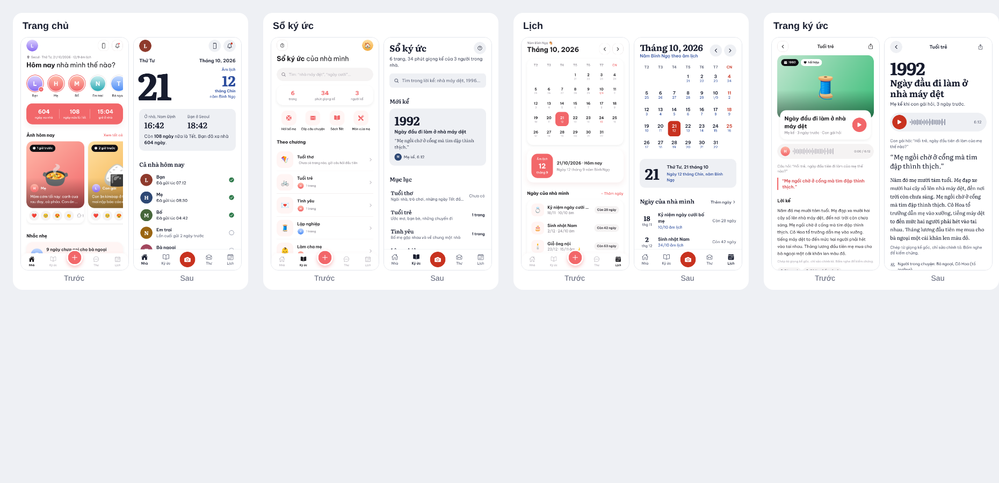

# Thiết kế Homeletter

Bản thiết kế này làm lại giao diện theo 3 bộ skill thiết kế trên GitHub:

- [anthropics/skills · frontend-design](https://github.com/anthropics/skills/tree/main/skills/frontend-design): chọn hướng thẩm mỹ riêng cho đúng chủ đề, tránh các "mặc định" của giao diện do AI tạo.
- [Leonxlnx/taste-skill](https://github.com/Leonxlnx/taste-skill): bộ luật "chống AI slop" (không gradient, không emoji làm icon, không thẻ giống hệt nhau, không nhãn chữ hoa nhỏ...).
- [nextlevelbuilder/ui-ux-pro-max-skill](https://github.com/nextlevelbuilder/ui-ux-pro-max-skill): luật cho app di động (độ tương phản 4.5:1, vùng chạm 44pt, một bộ icon, danh sách kiểm tra trước khi giao).

## Bản cũ sai ở đâu



| Dấu hiệu "AI slop" | Ở đâu trong bản cũ |
|---|---|
| Emoji thay icon và thay ảnh | Ảnh bài đăng là gradient + 🍲, chương ký ức 🪁🚲💌, sự kiện 🎂🕯️💍, lối tắt 🍲⏳📕❓, Thư là 🕊️ |
| Dải số lớn trên nền gradient | "604 ngày xa nhà · 108 ngày nữa là Tết · 15:15" trên dải san hô |
| Icon trong ô vuông tô màu | Hàng lối tắt ở Sổ ký ức, icon trong danh sách cài đặt |
| Thẻ giống hệt nhau, cùng bóng mờ | Gần như mọi khối đều là thẻ trắng bo 22px có bóng hồng |
| Chuỗi thông tin nối bằng dấu chấm giữa | "Seoul · Thứ Tư, 21/10/2026 · 12/9 âm lịch" |
| Nhãn viên thuốc khắp nơi | "1 giờ trước", "Bản demo", "Còn 28 ngày" |
| Chữ quá nhỏ | Nhiều nhãn 9 đến 11px, khó đọc với bố mẹ |
| Đánh số bước 01 / 02 / 03 | Màn hình tạo hồ sơ |

## Ý tưởng

> Trong Homeletter, **tờ lịch bóc treo tường** của mọi nhà Việt trở thành **trang chủ mỗi ngày**, còn **lá thư tay** là hình dạng của mọi lời nhắn.

Thử thay bằng đối thủ (Locket, Zalo, FamilyAlbum): câu này không còn đúng. Lịch bóc gắn với âm lịch, ngày giỗ, đếm ngày đến Tết, đúng những gì chỉ app này có.

## Màu

| Tên | Mã | Dùng cho |
|---|---|---|
| Giấy | `#FFFFFF` | Nền |
| Pơ-luya | `#EEF0F4` | Mặt nền thứ hai (tách khối bằng tông màu, không dùng viền hay bóng) |
| Mực | `#171C2E` | Chữ chính (mực bút bi viết thư) |
| Mực nhạt | `#5B6175` | Chữ phụ |
| Đỏ lịch | `#C8321F` | Nút chính, Chủ nhật, ngày lễ, Tết. Chỉ một màu nhấn |
| Xanh âm lịch | `#2C4D9E` | Ngày âm lịch, chỉ dùng cho âm lịch |

Màu riêng của từng người trong nhà (avatar, nền tin không ảnh), lấy từ chất liệu Việt: son `#8E3A2C`, chàm `#2E4874`, lá chuối `#46663A`, nghệ `#9A6512`, sen `#A2475E`, rêu `#3F6E68`, gốm `#7A5236`. Chữ trắng trên các màu này đều đạt từ 4.95:1 trở lên.

## Chữ

- **Literata** (chữ có chân, làm cho sách đọc lâu): số ngày lớn, tiêu đề màn hình, tên câu chuyện, lời trích, lời kể.
- **Be Vietnam Pro** (do người Việt thiết kế cho tiếng Việt): nút, danh sách, chat, nhãn.
- Cỡ chữ: 13, 15, 17 (thân bài), 22, 30, 120 (số trên tờ lịch). Không có chữ dưới 12px. Chế độ bố mẹ phóng to 1,18 lần.
- Viết hoa đầu câu, không dùng nhãn chữ hoa nhỏ giãn chữ.

## Hình khối

- Nút: bo tròn hẳn (viên thuốc), cao 52.
- Khối nền thứ hai: bo 18. Ảnh và tin: bo 6, giống ảnh in.
- Không bóng đổ cho vật đứng yên, không gradient, không kính mờ.
- Một bộ icon: Ionicons nét mảnh, cỡ 22. Emoji chỉ xuất hiện khi chính người dùng gửi (thả tim, cảm xúc).

## Ảnh

Bản demo **không dùng ảnh mạng, không dùng emoji thay ảnh**. Tin chưa có ảnh hiện thành "mẩu thư": lời nhắn in to bằng Literata trên nền màu của người gửi. Khi nhóm có ảnh thật (bữa cơm, Seoul, quê nhà), đặt vào `mobile/assets/demo/` và gắn `photo` cho bài đăng trong `src/data/seed.ts`.

## Bố cục chính

```
Trang chủ                         Sổ ký ức
┌──────────────────────────┐      ┌──────────────────────────┐
│ (L)        [chuông][widget]      │ Sổ ký ức                  │
│ Thứ Tư, tháng Mười       │      │ 6 trang, 34 phút giọng kể │
│ 21              ← 120px  │      │ [ Tìm trong lời kể      ] │
│ 12 tháng Chín, Bính Ngọ  │      │ Mới kể                    │
│ ┌ Pơ-luya ─────────────┐ │      │ 1975        ← Literata 56 │
│ │ Ở nhà 16:40  Seoul 18:40│      │ Gánh hàng ở chợ Rồng      │
│ │ Còn 108 ngày nữa là Tết│      │ “Bát nước chè xanh...”    │
│ └──────────────────────┘ │      │ ▶ Bà ngoại kể, 8:32       │
│ Cả nhà hôm nay           │      │ Mục lục                   │
│ (H) Mẹ    gửi lúc 17:20  │      │ Tuổi thơ          chưa có │
│ (M) Bố    gửi lúc 13:40  │      │ Tuổi trẻ           1 trang│
│ Tin mới  [mẩu thư] [ảnh] │      │ Theo năm 1975 1985 1992.. │
│ Sắp tới  18 thg 11 ...   │      │ Tất cả câu chuyện         │
└──────────────────────────┘      └──────────────────────────┘
```
